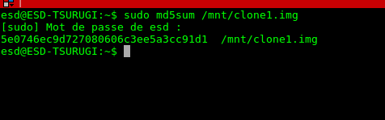
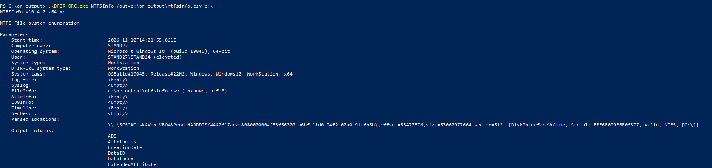
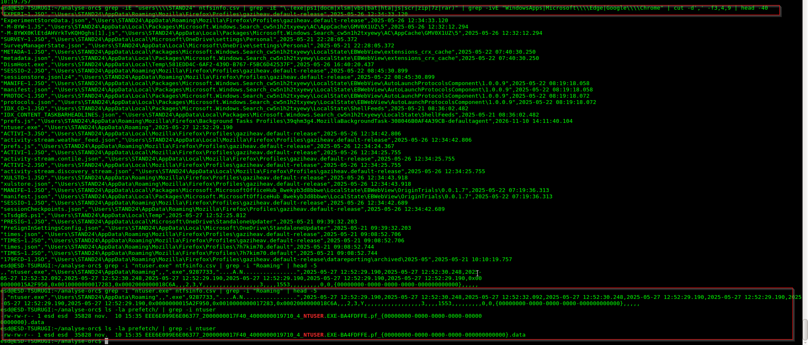
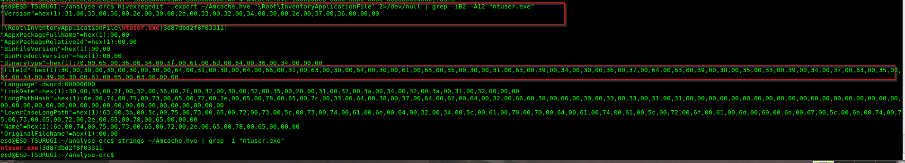

# 🔍 Investigation DFIR — Compromission d'un poste Windows

> Réponse à incident complète : acquisition forensique avec **DFIR ORC (ANSSI)**, analyse
> post-mortem multi-artefacts sur **Tsurugi**, et attribution d'un maliciel actif — de la collecte
> jusqu'au verdict VirusTotal.

**Type :** Digital Forensics & Incident Response (DFIR)
**Machine analysée :** `WIN10MAG` (Windows 10) · **Utilisateur :** `STAND24`
**Outils :** DFIR ORC v10.4.0 · Tsurugi Linux · hivexregedit · VirusTotal

📄 **[Rapport d'investigation complet (PDF)](./Rapport_DFIR_WIN10MAG.pdf)**

---

## 1. Résumé

Investigation forensique d'un poste Windows suspecté d'être compromis. L'analyse, menée selon une
démarche de réponse à incident (acquisition sous contrôle d'intégrité → collecte DFIR ORC →
analyse hors-ligne), a identifié et attribué un **maliciel actif** :

| | |
|---|---|
| **Fichier** | `ntuser.exe` (usurpe un nom système Windows) |
| **Emplacement** | `C:\Users\STAND24\AppData\Roaming\ntuser.exe` |
| **Nature** | Maliciel **Python / PyInstaller**, 64 bits, anti-analyse |
| **Verdict** | 🚨 **38 / 69 moteurs antivirus — malveillant (VirusTotal)** |

**Chaîne de preuve :** MFT (présence) → Prefetch (exécution) → Amcache (empreinte) → VirusTotal (attribution).

---

## 2. Architecture du lab

| Machine | Rôle |
|---------|------|
| `WIN10MAG` | Poste compromis analysé — **démarré sans réseau** (isolation totale) |
| `Tsurugi Linux` | Station d'analyse forensique (montage lecture seule) |
| Hôte VirtualBox | Hyperviseur — environnement isolé |

> **Sécurité :** poste infecté démarré sans carte réseau active, snapshot avant démarrage, outil
> transféré via partage **en lecture seule**, analyse disque en **montage lecture seule**. Binaire
> DFIR ORC téléchargé depuis la release officielle ANSSI et **vérifié par empreinte** avant usage.

---

## 3. Acquisition & chaîne de garde

- Image disque **bit-à-bit** réalisée depuis Tsurugi (disque source en lecture seule).
- **Empreinte MD5** calculée et consignée → garantit l'intégrité / la non-altération de la preuve.
- Collecte DFIR ORC : **MFT** (559 456 entrées), journaux `.evtx`, ruches `SYSTEM/SOFTWARE/SAM/SECURITY`, `NTUSER.DAT`, **Prefetch**, **Amcache**.



> Principe forensique : l'analyse ne porte **jamais** sur le disque original, uniquement sur des
> copies dont l'intégrité est prouvée par empreinte.

---

## 4. Collecte avec DFIR ORC

DFIR ORC est l'outil de collecte d'artefacts de l'**ANSSI**. Lancé sur le poste isolé, il embarque
plusieurs outils (`NTFSInfo`, `GetThis`, `RegInfo`…) et produit une collecte structurée.

```powershell
# Énumération de la MFT (timeline des fichiers)
.\DFIR-ORC.exe NTFSInfo /out=C:\or-output\ntfsinfo.csv c:\

# Extraction ciblée (journaux, ruches, prefetch, amcache)
.\DFIR-ORC.exe GetThis /nolimits /Sample=*.evtx /Out=C:\or-output\evtx.7z c:\Windows\System32\winevt\Logs
```



---

## 5. Analyse technique

### 5.1 Master File Table (MFT) — découverte

L'analyse de la MFT fait ressortir un exécutable anormal dans le profil de `STAND24` :

- **Masquerading** (T1036) : `ntuser.exe` n'existe pas nativement sous Windows (la ruche
  `NTUSER.DAT` oui, mais pas d'exécutable homonyme).
- **Emplacement** : `AppData\Roaming` → répertoire d'écriture utilisateur typique d'une persistance.
- **Timestomping** (T1070.006) : divergence des horodatages `$STANDARD_INFO` / `$FILE_NAME`.


### 5.2 Prefetch — preuve d'exécution

Le fichier `NTUSER.EXE-BA4FDFFE.pf` prouve que le binaire **a été exécuté**. La liste des
exécutions révèle aussi l'usage d'utilitaires compatibles avec une activité malveillante
(`wevtutil`, `schtasks`, `taskkill`, `powershell`).



### 5.3 Amcache — empreinte & attribution

L'Amcache conserve le **SHA-1** des binaires exécutés, calculé par Windows — permettant
l'identification **même sans disposer du fichier**.

| Champ Amcache | Valeur |
|---------------|--------|
| `LowerCaseLongPath` | `c:\users\stand24\appdata\roaming\ntuser.exe` |
| `BinaryType` | `pe64_amd64` |
| `LinkDate` | 26/05/2025 12:42:12 |
| `OriginalFileName` | *(absent — indice de malveillance)* |



### 5.4 Attribution — VirusTotal


- **38 / 69** moteurs antivirus → **malveillant**.
- **PyInstaller** : maliciel Python empaqueté (explique la taille de ~9 Mo).
- **detect-debug-environment** : évasion d'analyse / bac à sable (T1497).

### 5.5 Persistance — recherche méthodique

| Vecteur | Résultat |
|---------|----------|
| `HKCU\...\Run` / `RunOnce` | Légitime (OneDrive) / vide |
| `HKLM\...\Run` / `RunOnce` | Vide |
| Tâches planifiées | Toutes légitimes |
| Dossier Startup | Aucune entrée malveillante |

> Aucun vecteur d'autostart standard utilisé → persistance par mécanisme **non conventionnel**
> (piste : script `TSdgBS.ps1` identifié en zone temporaire). Point à approfondir.

---

## 6. Indicateurs de compromission (IOC)

| Type | Valeur |
|------|--------|
| Nom | `ntuser.exe` |
| Chemin | `%AppData%\Roaming\ntuser.exe` |
| Taille | 9 287 733 octets (8,86 Mo) |
| **MD5** | `cdc7b91327045d2464904c630650ac59` |
| **SHA-1** | `0d18df1c0d0ae501c94067dc9853947c5d490aec` |
| **SHA-256** | `a9b34637351ad139061a3fb239db0c0c8b0f43ba1b814f5909c96a07f3e4bea2` |
| Artefact lié | `TSdgBS.ps1` (`AppData\Local\Temp`) — à analyser |

---

## 7. Correspondance MITRE ATT&CK

| Technique | ID |
|-----------|-----|
| Masquerading | T1036 |
| Timestomp | T1070.006 |
| Virtualization/Sandbox Evasion | T1497 |
| Clear Windows Event Logs | T1070.001 |
| Command & Scripting : PowerShell | T1059.001 |

---

## 8. Recommandations

**Confinement :** isoler WIN10MAG, réinitialiser les identifiants de `STAND24`, bloquer les
empreintes sur l'EDR/antivirus du parc.
**Éradication :** réinstaller le poste à partir d'une image saine, rechercher les IOC sur le parc,
analyser `TSdgBS.ps1` et extraire le code Python du binaire PyInstaller en bac à sable.
**Durcissement :** Sysmon + PowerShell logging, restreindre l'exécution depuis `AppData`/`Temp`
(AppLocker/WDAC), superviser `wevtutil`/`schtasks` et la création d'exécutables dans `Roaming`.

---

## 9. Ce que ce projet démontre

- **Acquisition forensique** sous contrôle d'intégrité (chaîne de garde).
- Maîtrise de **DFIR ORC** (outil ANSSI de collecte, référence en réponse à incident).
- Analyse **multi-artefacts** Windows : MFT, Prefetch, Amcache, ruches de registre.
- Lecture de ruches en CLI (`hivexregedit`, décodage `hex(1)` UTF-16).
- **Recoupement de preuves** et **attribution** (VirusTotal), raisonnement d'analyste.
- Manipulation d'un **vrai malware en environnement isolé**, en sécurité.

---

## 👤 Auteur

**Waheed Nasiri** — en route vers l'analyse SOC / réponse à incident.
Profil réseau & sécurité en reconversion vers la cyberdéfense.

> Rapport réalisé dans un laboratoire personnel. Données issues d'un environnement d'entraînement
> contrôlé et isolé.
